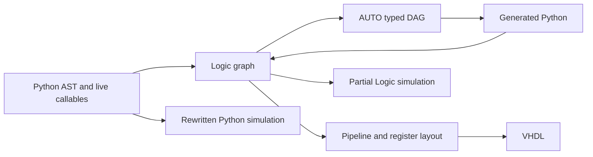

# PypelineC compiler complexity review

The best reduction strategy is to **remove repeated representations and shared plumbing before replacing the compiler framework**. Start with session-owned operator registration, common backend execution/reporting, and the cloned HDL generators. Then make the shared hardware graph typed enough that AUTO transformations can lower directly into it, and simulations can exercise the same semantics.

A wholesale MLIR/CIRCT migration is not the first recommendation. CIRCT is worth a bounded export/scheduling experiment, but it will not remove Pypeline's Python elaboration rules, measured FPGA pipeline placement, tool-feedback search or VHDL compatibility obligations automatically.

This report synthesizes all 33 individual reviews below. It describes recommendations, not implemented compiler changes.

## Table of Contents

- [Scope and coverage](#scope-and-coverage)
- [Measured concentration](#measured-concentration)
- [Reproduced findings](#reproduced-findings)
- [Why complexity accumulates](#why-complexity-accumulates)
- [Ranked recommendations](#ranked-recommendations)
- [Duplicate code and deletion targets](#duplicate-code-and-deletion-targets)
- [MLIR and CIRCT assessment](#mlir-and-circt-assessment)
- [Other tools and libraries](#other-tools-and-libraries)
- [An incremental implementation sequence](#an-incremental-implementation-sequence)
- [Validation and limitations](#validation-and-limitations)

## Scope and coverage

The reviewed working tree is based on commit `9eafa7d8` and includes another session's uncommitted multi-clock changes. [METRICS.json](METRICS.json) records hashes for the measured files. Line numbers can drift; use function names as navigation anchors.

There are individual reviews for all **31 substantive, nonlegacy top-level `src/*.py` modules**, plus the extensionless driver and a limited legacy FSM boundary assessment. Existing `*_DESIGN.md` documents were read as architectural context and checked against the relevant source paths. Longer modules received targeted reading of high-complexity routines, shared state, graph mutations, code generation and clone regions; this is not a claim that every line or every runtime configuration was audited.

Exclusions are explicit:

- `C_TO_LOGIC.py` is excluded as requested (the user's “C_TO_LOGI.py” refers to this file). No standalone review of its implementation was performed.
- `C_TO_FSM.py` has only a boundary/complexity assessment because its C control-flow lowering is outside the Python HDL path.
- Empty `src/__init__.py` and generated PLY `lextab.py`/`yacctab.py` have no handwritten Pypeline logic to review.
- Vendored `src/pycparser/` and `src/tests/` are not production Pypeline compiler modules. Tests were consulted as validation references, not individually reviewed.
- `include/pypeline/` is relevant library context, but a library-wide audit is outside this source-module review.

| Module review | Physical lines | Maximum function CCN |
|---|---:|---:|
| [pypeline](pypeline_COMPLEXITY_REVIEW.md) | 11,043 | 89 |
| [PY_TO_LOGIC](PY_TO_LOGIC_COMPLEXITY_REVIEW.md) | 10,151 | 65 |
| [pypeline_sim](pypeline_sim_COMPLEXITY_REVIEW.md) | 627 | 40 |
| [pypeline_sim_debug](pypeline_sim_debug_COMPLEXITY_REVIEW.md) | 302 | 32 |
| [pypeline_host](pypeline_host_COMPLEXITY_REVIEW.md) | 682 | 12 |
| [LOGIC](LOGIC_COMPLEXITY_REVIEW.md) | 3,959 | 82 |
| [AUTO](AUTO_COMPLEXITY_REVIEW.md) | 3,458 | 57 |
| [AUTO_COMB_OPT](AUTO_COMB_OPT_COMPLEXITY_REVIEW.md) | 424 | 66 |
| [AUTO_FSM](AUTO_FSM_COMPLEXITY_REVIEW.md) | 8,080 | 108 |
| [AUTO_PIPELINE](AUTO_PIPELINE_COMPLEXITY_REVIEW.md) | 5,174 | 119 |
| [AUTO_MULTI_CYCLE](AUTO_MULTI_CYCLE_COMPLEXITY_REVIEW.md) | 672 | 23 |
| [SWEEP](SWEEP_COMPLEXITY_REVIEW.md) | 9,446 | 339 |
| [SYN](SYN_COMPLEXITY_REVIEW.md) | 3,967 | 60 |
| [VHDL](VHDL_COMPLEXITY_REVIEW.md) | 7,500 | 203 |
| [RAW_VHDL](RAW_VHDL_COMPLEXITY_REVIEW.md) | 4,997 | 35 |
| [DEVICE_MODELS](DEVICE_MODELS_COMPLEXITY_REVIEW.md) | 1,963 | 65 |
| [SIM](SIM_COMPLEXITY_REVIEW.md) | 364 | 21 |
| [COCOTB](COCOTB_COMPLEXITY_REVIEW.md) | 353 | 19 |
| [CXXRTL](CXXRTL_COMPLEXITY_REVIEW.md) | 133 | 9 |
| [VERILATOR](VERILATOR_COMPLEXITY_REVIEW.md) | 203 | 17 |
| [MODELSIM](MODELSIM_COMPLEXITY_REVIEW.md) | 124 | 5 |
| [EDAPLAY](EDAPLAY_COMPLEXITY_REVIEW.md) | 25 | 3 |
| [VIVADO](VIVADO_COMPLEXITY_REVIEW.md) | 1,215 | 34 |
| [OPEN_TOOLS](OPEN_TOOLS_COMPLEXITY_REVIEW.md) | 1,831 | 39 |
| [QUARTUS](QUARTUS_COMPLEXITY_REVIEW.md) | 528 | 13 |
| [DIAMOND](DIAMOND_COMPLEXITY_REVIEW.md) | 478 | 20 |
| [EFINITY](EFINITY_COMPLEXITY_REVIEW.md) | 439 | 14 |
| [GOWIN](GOWIN_COMPLEXITY_REVIEW.md) | 615 | 15 |
| [CC_TOOLS](CC_TOOLS_COMPLEXITY_REVIEW.md) | 207 | 5 |
| [PYRTL](PYRTL_COMPLEXITY_REVIEW.md) | 335 | 12 |
| [utilities](utilities_COMPLEXITY_REVIEW.md) | 150 | 9 |
| [pipelinec driver](pipelinec_driver_COMPLEXITY_REVIEW.md) | 608 | 0; module-level flow is unscored |
| [C_TO_FSM boundary assessment](C_TO_FSM_COMPLEXITY_REVIEW.md) | 2,444 | 56; excluded from Pypeline totals |

## Measured concentration

The 31 substantive nonlegacy modules contain **79,445 physical lines**, **56,426 Lizard NLOC**, **214 functions with CCN > 15**, and **24 with CCN > 50**. These are source measurements, not runtime or reliability measurements.

| Routine | Physical span | CCN | Why it matters |
|---|---:|---:|---|
| SWEEP.DO_PLANNED_THROUGHPUT_SWEEP | 1,742 lines | 339 | Search state, observations, rollback and final artifact selection |
| VHDL.WRITE_MULTIMAIN_TOP | 1,399 lines | 203 | Clocks, global wiring, FIFOs and top-level connections |
| AUTO_PIPELINE.GET_PIPELINE_MAP | 1,029 lines | 119 | Stage availability and transaction alignment |
| AUTO_FSM emitter.generate | 559 lines | 108 | Register/state/control/functional-unit emission |
| VHDL.GET_PIPELINE_LOGIC_COMB_PROCESS_TEXT | 570 lines | 93 | Pipeline read/write and clock-enable semantics |
| pypeline._build_reg_sim_func | 498 lines | 89 | Independent implementation of HDL semantics in Python |

The highest LOGIC score belongs to C-only `MERGE_COMB_LOGIC`; the Pypeline priority is its shared graph mutation and trim/collapse machinery. Conversely, short code can be consequential: the CC_TOOLS parser defect below sits in a low-CCN function. Template-heavy RAW_VHDL also understates its maintenance burden in branch metrics.

## Reproduced findings

All reproductions and their exact limits are in [REVIEW_EXPERIMENTS.md](REVIEW_EXPERIMENTS.md).

| Finding | Evidence | Impact and next action |
|---|---|---|
| Scoped operator registrations outlive their scope identity | A new unrelated function reused a freed function's ID and received its NEGATE registration | Potential wrong implementation selection. Replace integer-ID ownership and test reparse/nested-scope lifetime. No complete miscompiled design was demonstrated. |
| Quartus clock commands lack separators | The real shared writer, with mocked IO and three clocks, concatenated three commands on one line | Malformed generated constraints. Emit one command per line and validate Tcl structure. Quartus was not run. |
| cocotb debug helper cannot write zero | Executing the actual generated helper template left a signal at 7 after a write of 0 | Incorrect stimulus through that helper. Distinguish absent argument from a falsy value. |
| CC_TOOLS accepts missing timing | Parsing a string with no timing returned a path with clock and delay both None | Invalid report object can reach downstream code. Validate the measurement before returning success. |
| STA chooses endpoint polarity before setup cost | Synthetic cells made run_sta return 11 ns while max(arrival + setup) was 19 ns | Algorithmic underestimation counterexample. Compare complete endpoint costs. Real-library error magnitude was not measured. |
| Constant evaluation conflates outcomes | Divide-by-zero, unknown name and literal None all returned None | Confirmed diagnostic information loss; not proven wrong hardware. Preserve value/dependency/error outcomes while respecting hardware-call detection. |

Repeated native-run cache retention, thread updates of MCP evidence, parser order assumptions and stale simulator file inventories are **suspected or structurally demonstrated risks**, not additional end-to-end reproduced failures. Individual reviews identify the distinction.

The handoff's claimed LOGIC clock-domain documentation drift was rechecked: the current document correctly says the Python frontend uses `PY_TO_LOGIC._assign_clocks`. It is not an outstanding finding.

## Why complexity accumulates

**The same meaning is repeatedly reconstructed.** Pypeline starts with decorated callables and Python ASTs, creates string-named Logic wires/submodules, reconstructs an AUTO DAG, sometimes emits new Python, elaborates that again, derives timing maps/register lifetimes and finally renders HDL. Operators, types, constants, effects and source identity are decoded at several boundaries.

**Mutable state lacks one owner.** Parse registries, scoped operators, timing caches, candidate plans, source snapshots and simulation state have different valid lifetimes. Today their lifetime is often expressed as “clear this module global at the right point.” The confirmed ID-reuse bug is a concrete consequence.

**Identity, presentation and physical evidence are mixed.** Entity/instance names encode semantic facts and later become timing-attribution keys. Renaming for readability can change compiler decisions. A correct refactor must retain stable logical identities and explicit emitted-name maps, not merely prettier names.

**Some abstractions already work well.** AUTO's shared graph/codegen base, the host serializer's shared leaf layout, typed physical placement records, MCP's shared endpoint-glob source and synthesis input manifests are useful foundations. Extend them before introducing parallel replacements.

## Ranked recommendations

Priority here combines correctness exposure, likely reduction and migration effort. Estimated line savings are planning judgments, not measured diffs.

| Order | Recommendation | Main payoff | Effort / deletion confidence |
|---|---|---|---|
| 1 | Fix the narrow reproduced defects; introduce owned operator scopes and a build session boundary | Correctness and repeatable reparsing | Small fixes; medium session refactor. High confidence in need, no reliable total line estimate |
| 2 | Share backend run preparation, artifacts, execution and report validation | Remove repeated plumbing across synthesis/simulation adapters | Medium. Roughly 300–700 net physical lines for synthesis scaffolding is plausible |
| 3 | Consolidate RAW_VHDL operator skeletons and OPEN_TOOLS pin templates | Largest straightforward textual duplication | Medium. Roughly 500–1,200 plus 250–500 net lines respectively |
| 4 | Type the shared graph and lower AUTO results directly into it | Remove decoding, type reconstruction and generated-source round trips | Large, highest architectural payoff. Prototype needed before estimating net deletion |
| 5 | Make sweep candidates/observations/actions explicit and rollback complete | Reduce interacting state and decision duplication | Medium/large. Expect lower cognitive complexity before substantial line reduction |
| 6 | Share operator semantics and develop an IR reference simulator | Reduce elaboration/simulation divergence | Large; depends on typed operations/effects. Do not promise removal of native fast paths yet |
| 7 | Separate semantic identity from naming; capture AST/metadata once | Fewer closure walks, naming branches and source-freezing workarounds | Medium. Some work overlaps session/IR changes |
| 8 | Centralize build modes and artifact consumption | Remove CLI/simulator policy duplication and stale-file discovery | Small/medium; useful independently of IR work |

### Session ownership and operator policy

A BuildSession should own transient elaboration registries, caches tied to a graph revision, frozen sources and the current build options. Persistent measurement storage is a separate service. Pin-and-confirm selections survive appropriate reparses within the session; live function/type objects do not leak into unrelated builds.

An OperatorRegistry should own exact/generic lookup, operator kind and scope precedence. Scope entries need real callable identity. A weak dictionary is not sufficient if its values indirectly retain the key; choose ownership deliberately. Keep library defaults reusable without retaining stale design registrations.

This boundary is more useful than copying the current globals into a large bag with no lifecycle rules. Evidence: [pypeline](pypeline_COMPLEXITY_REVIEW.md), [PY_TO_LOGIC](PY_TO_LOGIC_COMPLEXITY_REVIEW.md), [pypeline_sim](pypeline_sim_COMPLEXITY_REVIEW.md).

### Typed graph and direct lowering

Start with small records for types, values, operations, instances, source origins and effects. A combinational value should name its producer and type; constant values and opcodes should not require decoding wire/entity strings. Aggregate insert/extract operations can replace overlapping path/alias coverage machinery.

Add a verifier and a narrow compatibility view for current consumers. Move one AUTO combinational transform to emit this graph directly, deleting the corresponding generated-Python/elaboration detour when equivalence is established. Scheduled FSM lowering can follow once state, clock enables and storage lifetimes have explicit representation.

Do not put every graph-shaped object in one IR. AUTO's expression DAG, the instance hierarchy, a physical pipeline landscape and a timing-path graph have different nodes, edges and invariants. Share stable IDs and queries; retain purpose-specific analysis results. Evidence: [LOGIC](LOGIC_COMPLEXITY_REVIEW.md), [AUTO](AUTO_COMPLEXITY_REVIEW.md), [AUTO_FSM](AUTO_FSM_COMPLEXITY_REVIEW.md), [AUTO_PIPELINE](AUTO_PIPELINE_COMPLEXITY_REVIEW.md).

### Shared semantics and simulation

Define fixed-width operator behavior once: promotion, signedness, assignment truncation, exceptional cases and legality. Consume it from constant folding, typed interpretation and HDL operation selection. Keep target-specific implementation choices separate from the meaning of an operator.

Use the existing `_SimPipelineGraph` as a starting point for reference execution of elaborated hardware. State/feedback, memory, global wires, clocks, X values and custom models still need deliberate semantics. An IR simulator would expose elaboration bugs that source-only native execution cannot see. Retain optimized native simulation if it is valuable, and use differential tests to keep it aligned.

### Sweep state and artifact boundaries

Represent a candidate completely: timing table, placements, region constraints, concrete locks, MCP counts and identity. Pair it with an immutable observation. A decision routine returns an action; an executor runs tools or applies a transformation. Restore one complete candidate instead of many parallel `best_*` variables.

A final BuildResult should carry that candidate's artifact manifest and clock metadata to every simulator/host exporter. MODELSIM/EDAPLAY should stop scanning output directories, and the comparison CLI should establish identical final implementation identities. Evidence: [SWEEP](SWEEP_COMPLEXITY_REVIEW.md), [SYN](SYN_COMPLEXITY_REVIEW.md), [SIM](SIM_COMPLEXITY_REVIEW.md), [driver](pipelinec_driver_COMPLEXITY_REVIEW.md).

## Duplicate code and deletion targets

| Family | Located evidence | Consolidation boundary |
|---|---|---|
| Carry/compare and atomic operator templates | RAW_VHDL signed/unsigned PLUS, MINUS, comparisons, ACCUM; AND/OR/XOR/MULT and unary generators | Stage plan + type conversion + small operation-specific update. Preserve stateful and special QoR behavior |
| ECP5 pin declarations/maps | OPEN_TOOLS.GET_PRIMITIVE_MODULE_TEXT | Pin/width descriptors and loops |
| Single-instance synthesis wrappers | CC_TOOLS, DEVICE_MODELS, DIAMOND, EFINITY, PYRTL, QUARTUS; related OPEN_TOOLS/GOWIN variants | Common request construction |
| Synthesis project/run setup | QUARTUS/PYRTL and DIAMOND/EFINITY similarities | Shared runner with backend rendering/parsing hooks |
| Operator registration/resolution | pypeline left/unary/exact/generic/scoped families | One registry implementation parameterized by kind |
| Front-end expression dispatch | PY_TO_LOGIC binary/comparison, dynamic read/write indexing, branch CE muxes | Typed operator selection and shared addressing helpers |
| Recursive hierarchy predicates | AUTO_FSM, AUTO_PIPELINE, SYN/LOGIC state queries | One revision-scoped traversal, distinct predicates |
| HDL connection assembly | VHDL normal/crossing connections and read/write sides | Explicit connection records and port-map rendering |
| Simulation setup | CXXRTL/VERILATOR orchestration | Conversion/build artifacts and process runner, separate harness emitters |

The three relatively concrete deletion ranges in the ranked table target disjoint code families, but still need replacement implementations before they become credible savings. Do not count all clone-matched lines, comments or moved code as deleted complexity.

Other useful reductions have no honest line estimate yet: fewer manually copied metadata fields, fewer independent arithmetic evaluators, direct AUTO lowering, and removal of duplicated cache-lifecycle logic. A successful migration should remove its compatibility path once consumers move; permanent old/new implementations would increase maintenance.

## MLIR and CIRCT assessment

**Recommendation: use CIRCT as an optional interoperability/prototype target first; do not replace all graph objects wholesale.** This is an engineering inference from the source review and the documented capabilities below.

| Need in PypelineC | CIRCT fit | What remains local |
|---|---|---|
| Typed modules, instances and aggregate operations | `hw` has modules/instances and array/struct create/extract/inject operations. [HW dialect](https://circt.llvm.org/docs/Dialects/HW/) | Python annotations, closure specialization and partial-initialization policy |
| Combinational/stateful hardware lowering | `comb` and `seq` supply hardware operations, including register constructs. [Dialect catalog](https://circt.llvm.org/docs/Dialects/), [Seq dialect](https://circt.llvm.org/docs/Dialects/Seq/) | Exact promotion/cast semantics, effects, reset/CE and primitive contracts |
| Reuse optimization infrastructure | CIRCT provides hardware transformations and Verilog export passes. [Passes](https://circt.llvm.org/docs/Passes/) | Proving Pypeline's custom/stateful operations legal for CSE, DCE and movement |
| RTL emission | Documented output flow is Verilog/SystemVerilog. [Verilog generation](https://circt.llvm.org/docs/VerilogGeneration/) | Existing VHDL renderer/support libraries or a deliberately approved output migration |
| Static resource scheduling | Extensible scheduling problems/algorithms; SSP is an interchange/testing/prototyping dialect. [Scheduling](https://circt.llvm.org/docs/Scheduling/), [SSP rationale](https://circt.llvm.org/docs/Dialects/SSP/RationaleSSP/) | Measured operand mux/control costs, area search, binding/storage policy and vendor feedback |
| Compiled simulation | Arc represents state-transfer computation for simulation; arcilator is a candidate consumer. [Arc dialect](https://circt.llvm.org/docs/Dialects/Arc/) | Supported lowering subset, custom models, testbench hooks and equivalence with Pypeline clocks/state |

MLIR's SSA machinery would help only after meanings currently hidden in names, aliases and flags become explicit. Importing today's dictionaries unchanged into opaque attributes would retain most of the complexity while adding a native dependency.

The relevant scheduling comparison is not simply “does CIRCT have a scheduler?” It is whether a mapped scheduling problem reproduces dependency/chaining/resource constraints and reduces local policy code. SSP's own documentation advises production clients toward the C++ scheduling APIs; it is not a turnkey Python replacement for AUTO_FSM. Nor is static scheduling a substitute for SWEEP's iterative vendor timing experiments.

VHDL is a major decision boundary. Retaining it means the current renderer or a new lowering still has to exist. Generic canonicalization must also preserve clocks, CE, state/effects, custom operator scope, debug/simulation operations and timing-attribution identity. Pure arithmetic common-subexpression elimination is only a small part of that contract.

A useful prototype would:

1. Export a pure typed integer/aggregate subset from Logic to `hw`/`comb`, with explicit widths and source origins.
2. Verify and canonicalize it, emit SystemVerilog, and compare behavior with current VHDL for the same function.
3. Add one register/CE example and a custom black box, checking latency and interface fidelity.
4. Separately export a small AUTO scheduling problem to SSP for solution/runtime comparison.
5. Record exporter/adapter lines added, existing lines actually removable, compile time, distribution size and failure diagnostics.

Adopt a larger migration only if the prototype removes an actual representation/implementation and preserves required output/tool support. An exporter that permanently adds a fourth graph conversion may still aid verification, but it is not a code-reduction success.

Local probing found no CIRCT modules or executables. No lowering or performance experiment ran. The official [Python binding build instructions](https://circt.llvm.org/docs/PythonBindings/) describe a combined LLVM/MLIR/CIRCT build; Python-wheel compatibility on this machine was not established.

## Other tools and libraries

- **OpenSTA as a reference or optional backend.** Its documented inputs include Liberty, Verilog and SDC, overlapping the custom DEVICE_MODELS timing engine. Compare complete endpoint costs, coverage and runtime on identical mapped netlists before extending or replacing local STA. Startup overhead for many small jobs and distribution/license requirements need evaluation. No measured superiority is claimed. [OpenSTA project](https://github.com/The-OpenROAD-Project/OpenSTA)
- **Yosys EQY for refactor equivalence.** EQY is designed to compare hardware implementations formally. It is a good candidate for proving RAW_VHDL consolidation and direct-IR lowering on supported circuits, alongside existing GHDL/native checks. Define initialization, undefined values and latency correspondence; a proof of the wrong equivalence contract is not useful. EQY was not run here. [Official quickstart](https://yosyshq.readthedocs.io/projects/eqy/en/latest/quickstart.html)
- **Lightweight typed Python records before a graph framework.** Dataclasses/explicit enums and a small verifier can remove parallel dictionaries and marker conventions without adding a graph-library dependency. Generic graph traversal libraries do not supply hardware typing, use-def legality, clock effects or HDL emission. Adopt one only if profiling or a concrete algorithm justifies it.
- **Structured formats before new parsers.** Prefer machine-readable timing rows/JSON and actual XML construction where tools support them. DEVICE_MODELS already has structured results; stop parsing its own prose back into the main representation. Keep separate vendor grammars behind a shared validation schema.
- **Lizard plus clone analysis as review aids.** Keep a lightweight report of changed-function complexity and duplication. Use it to prompt review, not an arbitrary threshold that encourages splitting functions without simplifying state. Treat static dead-code scans as leads, especially around reflection/generated code.
- **Property/equivalence tests instead of more hand-maintained semantic examples.** Exhaustive small widths and generated aggregate/cast cases can test a shared operator specification and rewrite legality more directly than textual snapshots. Add a property-testing dependency only if it materially simplifies those generators.

## An incremental implementation sequence

1. **Small correctness changes, separately reviewable:** scope identity, command separators, zero-valued stimulus, missing timing rejection and STA endpoint selection. Convert the probes into focused regression tests. Avoid coupling these fixes to an IR migration.
2. **Introduce one common run/result boundary:** migrate two synthesis backends first, retain vendor-specific parsers, and remove their old duplicated setup. Add exact simulation artifact lists. Prove cold/warm reuse and failures behave the same.
3. **Consolidate one RAW_VHDL family:** begin with atomic bitwise operations or rotations, compare generated behavior across widths/latencies, then tackle carry/compare skeletons. Measure net deletion including helpers.
4. **Establish session and typed graph ownership:** capture frozen function descriptors, define graph mutation/verification and revision-scoped caches. Migrate one AUTO combinational path directly into the graph and retire its source round trip.
5. **Extract sweep decisions over complete snapshots:** replay existing observations to preserve decisions and compare QoR/tool-run counts. Keep heuristic changes out of a purely structural refactor.
6. **Evaluate CIRCT and IR simulation against explicit exit criteria:** required semantics/output supported, one old implementation removable, acceptable build/runtime/deployment cost. Stop at optional export if those conditions are not met.

Do not simultaneously rewrite the frontend, scheduler, simulator and HDL backend. Their current differential behavior is valuable evidence during migration. Also do not delete C support solely to improve a Pypeline line count; legacy retirement needs a separate scope decision.

## Validation and limitations

The individual reviews include validation cases for each proposed change. The source review and probes establish implementation risks and narrow failures; they do not establish overall compiler correctness or quantify performance gains.

For follow-up refactors, compare the same designs with the same tool versions, target settings and cache state. Check functional/cycle equivalence, graph invariants, name-to-instance attribution, realized latency, timing/area QoR, synthesis-call count and actual net source deletion. A pass on small arithmetic leaves does not prove a change to global wiring or sweep policy.

This documentation-only work leaves compiler source and pre-existing working changes untouched. Validation completed: the repository documentation checker passed all seven test functions (78 Markdown files, zero broken links); all seven embedded shell probes completed successfully; all 33 individual reviews are linked above; and every recorded source hash still matched at validation. The probes reproduced the stated narrow behaviors. No full compiler regression suite, external synthesis or CIRCT lowering was run.

