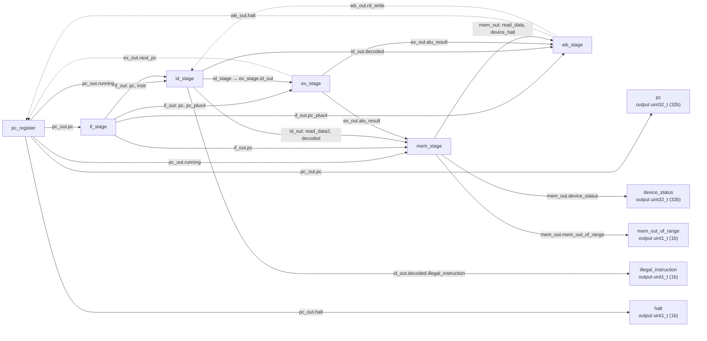

# Single-cycle RV32I CPU

The core executes one little-endian RV32I instruction per clock. The example top builds the C demo or a selected ISA test during design import. Start with the
[example commands](../../../examples/pypeline/riscv/README.md).

## The datapath

[`single_cycle.py`](single_cycle.py) builds the single-cycle datapath of
Patterson & Hennessy's *Computer Organization and Design, RISC-V Edition*
(chapter 4) and Harris & Harris's *Digital Design and Computer Architecture,
RISC-V Edition* (chapter 7). Each of the five stages is its own function, and
the signals use the books' names. One instruction passes through all five in
one clock cycle. A stage's output struct holds the values that leave it,
roughly what a pipelined core keeps in its IF/ID, ID/EX, EX/MEM and MEM/WB
registers.

| Stage | Textbook blocks | Function | Notes |
|---|---|---|---|
| — | PC | `pc_register` | Loads the next PC at the clock edge. A halt sends it to the reset vector and stops the core |
| IF | Instruction memory, PC + 4 adder | `if_stage` | Passes the PC on, as the IF/ID register does |
| ID | Control unit, immediate generator, register file | `id_stage`: `rv32i.decode`, `rv32i.imm_gen`, `register_file` | Instruction fields `rd`, `rs1`, `rs2`, `funct3`, `funct7`; control signals `reg_write`, `result_src`, `mem_read`, `mem_write`, `pc_src`; `read_data1`, `read_data2` |
| EX | ALU, branch comparator, PC + imm adder, PCSrc mux | `ex_stage`: `rv32i.execute`, `rv32i.next_pc_mux` | One result: the ALU value, the memory address, or a jump or branch target |
| MEM | Data memory | `mem_stage` | Byte and halfword lanes, alignment checks, and the memory-mapped device |
| WB | ResultSrc mux | `wb_stage`: `rv32i.result_mux` | The register write goes back to the register file, and ECALL, EBREAK or a device request goes back to the PC as a halt |

The book figures decide a branch with the ALU's Zero flag and a separate
target adder. Here `execute` compares the registers itself and returns the
branch's next PC, target or PC + 4, so `pc_src` is set for every branch and
jump. Loads and stores also handle bytes and halfwords, which the book
figures leave out.

This is the core's view in the example's `diagram.html`
([Viewing the design](../../../docs/README.md#viewing-the-design)), copied with
**copy as Mermaid**. Dotted edges go through a `Feedback`: a value a later stage
computes and an earlier one uses in the same cycle.



To refresh it after changing the core, build the example with `--comb --no_synth`,
open `diagram.html`, go to `passed` and then `core`, and copy the view again.

## Address map and reset

| Default byte address | Contents |
|---|---|
| `0` through `IMEM_SIZE - 1` | Instruction ROM, reset vector at zero |
| `0x40000000` through `0x40000000 + DMEM_SIZE - 1` | Read/write data, including constants, globals and the descending stack |
| `0x80000000` through `0xffffffff` | Memory-mapped devices |

Each region has its own byte base and size. Choose non-overlapping regions in
any order, with word-aligned bases and positive whole-word capacities. Gaps
remain unmapped. Constructing an `AddressMap` checks these constraints. Its
`imem_last`, `dmem_last` and `mmio_last` properties give the inclusive last
byte of each region. The hardware uses `address_in_range` for membership and
`region_offset` for the byte offset from a RAM base. Instruction fetches must be word-aligned. The IMEM base is
the reset vector. On the example top, use `-D IMEM_BASE=...`, `DMEM_BASE`,
`MMIO_BASE` and their corresponding `*_SIZE` parameters to set the regions.
`TOHOST` defaults to the MMIO base and occupies two words inside it.

RV32I leaves misaligned load/store behavior to the execution environment.
This core supports naturally aligned accesses only. A byte may use any address,
a halfword an even address, and a word an address divisible by four. For
example, at DMEM base + 2, a halfword succeeds and a word fails. At base + 1
even a halfword fails, though both bytes fit in one RAM word. An invalid
access fails simulation with the PC and instruction word. Hardware suppresses
the memory transfer and signals `mem_out_of_range` for that instruction. It
continues executing without taking an architectural exception. Firmware must use
naturally aligned accesses. The PipelineC single-cycle implementation checked
only for accesses spilling across a word boundary. Its DMEM write path could
also alias an out-of-range store onto a RAM word. Here both the region and
alignment checks qualify a RAM write. See the [RV32I load/store specification](https://docs.riscv.org/reference/isa/unpriv/rv32.html).

Use `@MAIN(reset=rst, reset_registers="all")` on the enclosing top. Reset
restarts the PC at the IMEM base and clears the halt and device registers. Both memories
and the register file retain their contents. The architectural x0 always reads
zero. C startup sets the stack pointer and clears `.bss` on every boot.
Initialized writable `.data` retains the program's last writes across reset.
Reload the image to restore its initial values.

## Core and device port

```python
from cpu.mem_map import AddressMap
from riscv.sim_ctrl import make_sim_ctrl_device
from riscv import firmware
from riscv.single_cycle import make_rv32i_single_cycle_core

# MMIO below both RAMs, with unmapped space between the regions.
layout = AddressMap(
    imem_base=0x8000, imem_size=1024, dmem_base=0x10000, dmem_size=2048,
    mmio_base=0x400, mmio_size=128, tohost=0x440,
)
fw = firmware.build(sources=[source], layout=layout)
core = make_rv32i_single_cycle_core(
    imem_init=fw.imem_init, dmem_init=fw.dmem_init,
    layout=layout, mem_map=make_sim_ctrl_device(tohost=layout.tohost),
)
```

Call `core()` once per clock. Separate call sites instantiate independent cores, including when they use the same factory result. Each factory can take its own layout, firmware and device. The single-cycle result gives the current
`pc`, `illegal_instruction`, `mem_out_of_range`, `halt` and live `device_status`.
ECALL, EBREAK and a device halt request each stop execution. On the first halt
cycle the PC identifies the stopping instruction. At the edge it returns to the
reset vector, where it stays until reset. Register writes and RAM/MMIO
transfers are disabled on subsequent cycles. The peripheral continues clocking.
A testbench that needs the stopping PC or fault flags captures them on the first
halt cycle. FENCE completes in one cycle. The Harvard core
has read-only instruction memory and provides no CSRs, traps or FENCE.I.

A custom `@hw_func` device takes `addr: uint32_t`, `wr_data: uint32_t`,
`wr_byte_ens: uint1_t[4]` and `rd_byte_ens: uint1_t[4]` as named inputs.
It receives a word-aligned byte address. Byte enables and store data are
shifted to their little-endian word lanes. Both enables are clear for an idle
or invalid transfer. Return a `cpu.mem_map_port.riscv_mem_map_mod_out_t` with
`addr_is_mapped`, combinational `rd_data`, a `halt` request and a 32-bit
`device_status` word for the caller. A one-cycle request suffices. The core
checks the address claim for active MMIO accesses, selects the requested
load lanes, and sign-extends LB and LH.

C startup and the ISA tests report completion by writing the linked `tohost`
symbol. This exit mailbox is a host-interface convention and can be used with
or without a trap handler. There is no inbound `fromhost` channel.
The simulation-control device accepts full-word stores to `TOHOST` at
the configured mailbox address (default `0x80000000`). A store of 1 finishes successfully. An odd code
`(n << 1) | 1` with nonzero `n` fails with the test number or C return
value. An even code or a partial store also fails. In hardware the device requests halt on the low-word store and
holds the raw exit code from a full-word write until reset. The example drives
its success pin when that code equals 1. The upper word at `TOHOST + 4`
accepts stores and both words read zero.

## Building firmware

`firmware.build(*, sources, layout, includes=(), bootstrap=True, project_dir=None)` returns two lists of 32-bit words sized to the memory
windows. Pass paths relative to the invoking directory or anchor a source to
the design with `Path(__file__).with_name("main.c")`. Set `-D RISCV_GCC=...`
or the `RISCV_GCC` environment variable to select gcc. Otherwise the helper
searches PATH for `riscv32-unknown-elf-gcc`, then its conventional installation
under `/opt/riscv/bin`.

The command runs in a fresh temporary directory on each import.

```sh
riscv32-unknown-elf-gcc -march=rv32i -mabi=ilp32 -O2 -nostdlib -nostartfiles -T link.ld -MD -I... bootstrap.S sources... -lgcc -o fw.elf
```

The firmware build follows the [PipelineC firmware example](../../../examples/pico-ice/ice_makefile_pipelinec/risc-v/firmware/Makefile), which credits [MicroRV32’s basic C build](https://github.com/agra-uni-bremen/microrv32/tree/master/microrv32/sw/basic-c). Its [linker script](../../../examples/pico-ice/ice_makefile_pipelinec/risc-v/firmware/link.ld) also thanks dutracgi and cites the [Memfault linker-script guide](https://interrupt.memfault.com/blog/how-to-write-linker-scripts-for-firmware).

The PipelineC script fixes the RAM addresses and groups data, constants and BSS
in a RAM section with its load address in ROM. Here the linker takes the same
layout as the core, and the loader initializes each RAM directly. A separate
NOLOAD BSS section gives startup precise bounds for clearing it on reset.
The linker emits separate ELF load segments for IMEM and DMEM so neither includes ELF headers when the base is inside a page. It puts `.text.init` first, maps read-only data and writable data to
DMEM, and defines `__stacktop`, `__bss_start`, `_end` and `tohost`. C builds
start at `_bootstrap`. Assembly with its own entry sets `bootstrap=False` and
defines `_start` at the IMEM base. The loader checks ELF class, endianness, machine,
entry and segment bounds. It places file bytes by virtual address, zero-fills
the rest of each loadable segment, and skips disjoint NOLOAD segments.

The import declares the sources and transitive project and toolchain headers
from gcc's dependency information. One compile-and-link command writes every
source's list to the same `fw.d`, so with several sources the helper also asks
the preprocessor for the earlier sources' lists. The generated startup, linker
script and temporary ELF stay private. A repeated build detects edits to declared inputs.
To use a prebuilt ELF call `firmware.load(path=elf_path, layout=layout)`. This
also declares the ELF as a build input. Specify `project_dir=` to export the
Makefile, linker script and optional startup for manual builds. Each file is
replaced atomically when its content changes. The example opts in only when
you export a project explicitly.

## ISA tests and traces

The trap-free environment follows the example of [PicoRV32’s test header](https://github.com/YosysHQ/picorv32/blob/main/tests/riscv_test.h). The single-cycle datapath is adapted from the [PipelineC implementation](../../../examples/risc-v/risc-v_decl.h).

The [pinned upstream copy](riscv-tests/README.md) contains 42 rv32ui
assembly wrappers and their rv64ui includes. Forty run under a trap-free
environment, with `gp` holding the current test number. `fence_i` needs writable
instruction memory and `ma_data` needs misaligned data access.

Set `-D ISA_TEST=rv32ui/add` on the example top. Use `--run all` so the program
runs to its exit store. The top asserts a `MAX_CYCLES` deadline.
`-D RISCV_TRACE=1` prints, for each instruction, the PC and
instruction word, the register write (`reg_write`, `rd` and the data), and
the memory access (`mem_write`, the address, rs2's value and the unshifted
byte mask). It prints before the memory stage, so a store that ends the
simulation still appears. The [test reference](../../../docs/pypeline_TESTS.md#risc-v-cpu-coverage)
covers the native/GHDL comparisons.
